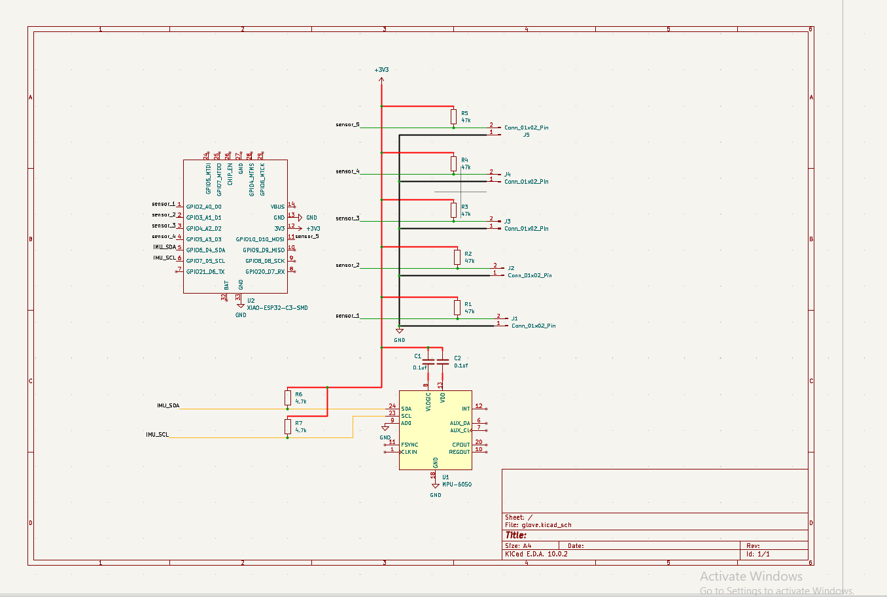
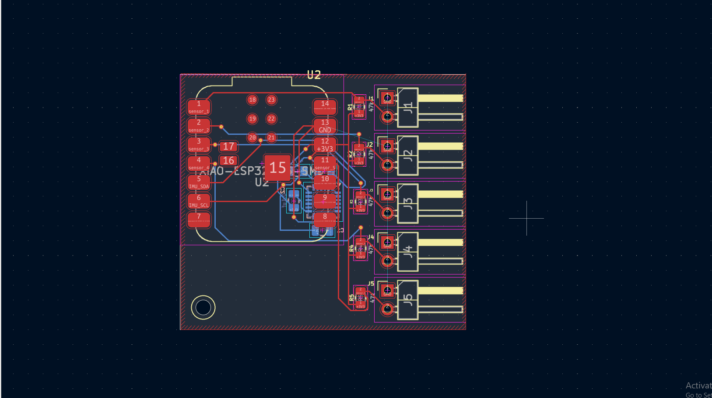
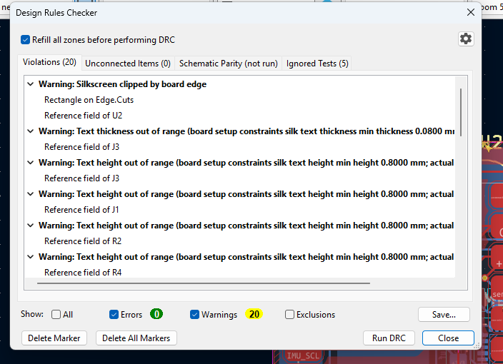

# BdSL Translator Glove

The **BdSL Translator Glove** is a wearable device designed to translate BdSL into words without any camera setup.

## How It Works

*   **Sensors:** The glove tracks movement using bend sensors or custom, flexible 3D-printed tpu that changes its voltage when your fingers move.
*   **Brain:** An esp module tracks exactly how your hand moves and tilts, turns those gestures into data, and sends the translated speech to a device.

## Recent Design Updates

*   **Lower Cost:** Switched to smaller sensors, cutting the hardware budget down to about $100 for a full two-handed setup.
*   **Better Fit:** Upgraded the design from a clunky plastic box to form-fitting, flexible finger guides that follow the shape of the hand.

## Finger Guides

Shoutout to [zackfreedman](https://www.thingiverse.com/thing:1606915) for the original parametric ring glove concept that inspired this design. You can grab my modified STL [here](https://github.com/Adnanosman9/Smart-Gloves/blob/main/CAD%20for%20flex%20sensor/Ring_Glove_Parametric.stl).

Instead of messing around with messy glues or tape, each finger uses a 3D-printed TPU channel segment where the sensor just slides right in and locks mechanically. I split these into two sizes:
*   **Long:** For your index, middle, and ring fingers.
*   **Short:** Form-fitted for the thumb and pinky to match their shorter lengths and natural joint angles.

Any standard FDM printing service can easily run these off in white TPU filament.

---

## PCB Design

I put together a compact wrist hub in KiCad to keep the electronics tidy. A few design choices:

*   **Brain:** The **XIAO ESP32-C3** was a no-brainer. It's incredibly small, handles Bluetooth LE natively, and has just enough ADC pins for all 5 fingers.
*   **Hardware Filtering:** Because flex sensors have a pretty high impedance, I added a **47kΩ voltage divider** on every sensor input to keep readings steady. I also threw in **0.1µF decoupling capacitors** along the sensor traces to smooth out some electrical noise I ran into during early testing.

The KiCad DRC checked out cleanly with 0 errors (just a few minor silkscreen overlap warnings that won't disrupt manufacturing).

**Schematic:**

**PCB Layout:**

---

## Enclosure

The wrist housing was designed in Fusion 360 to keep the pcb safe. 

### Get the CAD assembly [here](https://github.com/Adnanosman9/Smart-Gloves/blob/main/CAD%20for%20flex%20sensor/assembly.f3z)

---

## Alternative of commercial Sensors

Here is an alter for commercial sensors for cost optimization. 

*   [Middle, Index, & Ring fingers](https://github.com/Adnanosman9/Smart-Gloves/blob/main/CAD_3d%20printed%20sensor/Mid%20fingers-TPU.f3z)
*   [Pinky & Thumb fingers](https://github.com/Adnanosman9/Smart-Gloves/blob/main/CAD_3d%20printed%20sensor/Pinky_Thumb_finger--TPU.f3z)

---

## Firmware Status

**Just a quick heads up:** I haven't been able to run this code on physical hardware yet. It's highly likely there are some I2C pin configuration mismatches, flipped GPIO definitions, or sensor initialization bugs waiting to happen on the first boot. Please double-check your schematic assignments against your software configuration before flashing! 

## Bill of Materials

You can view the full parts list in the [BOM file here](bom/BOM.csv).

> GitHub [@Adnanosman](https://github.com/Adnanosman9)
